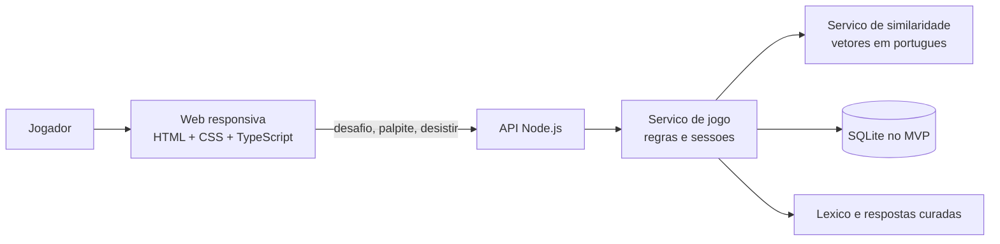

# Documento Tecnico de Projeto: Puxa Palavra

**Versao:** 0.1  
**Status:** proposta tecnica para orientar a implementacao  
**Data:** 20/10/2026  
**Base:** requisitos levantados na elaboracao do PRD e prototipos em `prototipos.html`

## 1. Objetivo

Definir uma arquitetura implementavel para um jogo casual de adivinhacao semantica em portugues brasileiro. O jogador digita palavras, recebe uma indicacao qualitativa da proximidade em relacao a uma resposta secreta e pode continuar sem limite de tentativas ou desistir para revelar a resposta.

O documento descreve uma implementacao funcional, nao apenas o comportamento demonstrativo atual. O prototipo em HTML e uma referencia de interface: suas listas pequenas de palavras proximas nao representam um mecanismo semantico real.

## 2. Escopo do MVP

### Incluido

- Aplicacao web responsiva, em portugues brasileiro.
- Desafio diario com a mesma resposta para todos os jogadores, renovado a meia-noite no fuso `America/Sao_Paulo`.
- Acesso a desafios diarios anteriores.
- Modo de treino ilimitado, com uma nova palavra aleatoria por rodada e sem repeticao imediata.
- Entrada livre de uma palavra por palpite, validada contra um lexico de palpites.
- Respostas comuns selecionadas e revisadas editorialmente.
- Normalizacao de acentos para comparacao, mantendo a forma original na interface.
- Feedback em texto por faixas qualitativas: **Frio**, **Morno**, **Quente** e **Correto**.
- Tentativas ilimitadas; acao **Desistir e revelar** disponivel na rodada.
- Progresso pessoal persistido no navegador e dispositivo atual, sem conta.
- Direcao visual adaptavel a Atlas, Laboratorio ou Cartaz, mantendo a mesma estrutura e os mesmos estados do jogo.
- Sem anuncios, monetizacao, recursos sociais ou coleta de metricas de produto no MVP.

### Fora do escopo inicial

- Sincronizacao de progresso entre dispositivos.
- Ranking, desafios entre amigos e compartilhamento social.
- Categorias e colecoes tematicas.
- Dicas editoriais, definicoes, etimologia ou explicacao da resposta.
- Aplicativos nativos para iOS ou Android.
- Painel editorial para cadastrar palavras. A curadoria inicial pode ser feita em arquivos versionados.

## 3. Direcao visual e experiencia

Os tres conceitos apresentados no prototipo compartilham o mesmo fluxo; mudam tipografia, composicao, cores e tratamento visual do feedback. O codigo deve permitir trocar o tema sem duplicar as regras do jogo.

**Referencia inicial:** Atlas, por ser a opcao ativa por padrao em `prototipos.html`. A selecao final entre Atlas, Laboratorio e Cartaz ainda nao foi confirmada explicitamente e deve ser validada antes do fechamento visual.

Principios comuns aos tres temas:

- Identificar com clareza **Desafio diario** e **Treino livre**.
- Dar prioridade ao campo de palpite, ao feedback e ao historico da rodada.
- Mostrar as faixas de proximidade com texto, nunca apenas com cor.
- Manter a acao de desistir visivel, mas secundaria ao envio do palpite.
- Preservar os mesmos nomes, estados e ordem de foco entre temas.
- Usar tokens CSS para cores, tipografia, espacamento, bordas, foco e estados.

## 4. Fluxos principais

### 4.1 Desafio diario

1. A aplicacao consulta o desafio atual ao servidor.
2. O jogador envia uma palavra por vez.
3. O servidor valida a forma normalizada e calcula sua proximidade semantica em relacao a resposta.
4. A interface acrescenta o palpite e o rótulo **Frio**, **Morno**, **Quente** ou **Correto** ao historico.
5. Em caso de acerto, a rodada termina e a resposta e mostrada.
6. O jogador pode desistir a qualquer momento; a interface solicita a revelacao da resposta e encerra a rodada.
7. A partir da meia-noite de Brasilia, a nova rodada fica disponivel. Rodadas anteriores permanecem acessiveis no arquivo.

O feedback e comparado diretamente com a resposta secreta, nao com o palpite imediatamente anterior.

### 4.2 Treino livre

1. O jogador inicia o treino.
2. O servidor seleciona aleatoriamente uma resposta elegivel e cria uma sessao de treino.
3. Os palpites seguem as mesmas regras do desafio diario.
4. Ao acertar ou desistir, o jogador pode pedir outra palavra.
5. A proxima resposta deve ser diferente da resposta imediatamente anterior da mesma sessao/local de jogo.

### 4.3 Validacao de palpite

- Remover espacos no inicio e no fim.
- Rejeitar entrada vazia, espacos internos, numeros, pontuacao ou mais de uma palavra.
- Normalizar maiusculas e diacriticos para comparacao: por exemplo, `música` e `musica` tem a mesma chave.
- Validar a forma normalizada contra o lexico de palpites.
- Rejeitar repeticoes da mesma palavra normalizada na rodada, com mensagem compreensivel.
- Preservar e exibir a forma digitada pelo jogador.
- Nao limitar o numero de tentativas.

## 5. Arquitetura proposta

O repositorio atual contem apenas `README.md` e `prototipos.html`, sem configuracao de build, dependencias ou servidor. A arquitetura abaixo e uma proposta para a implementacao, nao uma descricao de infraestrutura existente.

### 5.1 Componentes



### 5.2 Stack inicial recomendada

- **Cliente:** HTML semantico, CSS e TypeScript com Vite para desenvolvimento e build estatico.
- **Servidor:** Node.js LTS com Fastify e validacao de esquemas na fronteira HTTP.
- **Persistencia do servidor:** SQLite para configuracao, calendario de desafios e sessoes curtas. Se a hospedagem usar varias instancias concorrentes, migrar para PostgreSQL antes de escalar.
- **Progresso pessoal:** `localStorage` versionado; nao armazenar informacoes pessoais ou credenciais.
- **Testes:** Vitest para logica, Playwright para fluxos de navegador e axe-core para verificacoes automatizadas de acessibilidade.
- **Similaridade:** adaptador de dominio com vetores de palavras em portugues gerados previamente a partir de um modelo pre-treinado. O modelo e o conjunto de dados devem ser selecionados apos benchmark linguistico e verificacao de licenca.

TypeScript e Vite sao adequados para separar a logica sem introduzir um framework de interface que o prototipo atual nao utiliza. O servidor e necessario porque respostas e vetores nao devem ser enviados junto com o cliente: isso permitiria inspecionar as respostas diarias e a base semantica.

### 5.3 Estrutura sugerida

```text
src/
  client/
    main.ts
    api/
      game-client.ts
    components/
      mode-picker.ts
      guess-form.ts
      attempt-history.ts
      result-panel.ts
    styles/
      tokens.css
      themes.css
      game.css
    storage/
      progress-store.ts
  server/
    app.ts
    routes/
      puzzles.ts
      sessions.ts
      guesses.ts
    game/
      game-service.ts
      word-normalizer.ts
      guess-validator.ts
      temperature.ts
    similarity/
      similarity-provider.ts
      vector-provider.ts
    data/
      puzzle-repository.ts
      word-repository.ts
  shared/
    api-schemas.ts
    game-types.ts
data/
  answers.json
  accepted-words.json
  vectors/
scripts/
  validate-word-data.ts
  build-word-vectors.*
tests/
  unit/
  integration/
  e2e/
```

Os artefatos do modelo podem exigir outro processo de geracao, por exemplo um script Python. A API de runtime permanece isolada pelo contrato `SimilarityProvider`; assim, trocar o modelo nao exige reescrever as regras ou a interface.

## 6. Dominio e dados

### 6.1 Entidades

**Word**

- `id`: identificador estavel.
- `display`: forma editorial com acentos.
- `normalized`: forma normalizada usada em igualdade e busca.
- `isGuessAllowed`: indica se pode ser aceita como palpite.
- `isAnswerEligible`: indica se pode ser resposta.
- `vectorKey`: chave no conjunto de vetores, quando disponivel.
- `editorialNotes`: notas privadas de curadoria, se necessarias.

**Puzzle**

- `id`: identificador estavel do desafio.
- `answerWordId`: referencia privada a resposta.
- `publishDate`: data civil no calendario de `America/Sao_Paulo`.
- `status`: rascunho, publicado ou retirado.
- `temperatureProfileVersion`: versao da calibracao das faixas.

**GameSession**

- `id`: token opaco da sessao.
- `mode`: diario ou treino.
- `puzzleId`: desafio associado, quando diario.
- `answerWordId`: armazenado apenas no servidor.
- `createdAt` e `expiresAt`: validade de sessao de treino.

O progresso detalhado local pode guardar `puzzleId`, palpites, estado final e horario da ultima atualizacao. Nao e necessario criar conta ou enviar esse historico ao servidor.

### 6.2 Curadoria e distribuicao

- Manter listas distintas para respostas elegiveis e palpites aceitos.
- Respostas devem ser comuns, apropriadas para publico geral e revisadas por uma pessoa.
- O lexico de palpites pode ser mais amplo que a lista de respostas.
- Cada resposta precisa ter vetor valido ou regra editorial de fallback; nao publicar palavras sem resultado de similaridade testado.
- Versionar dados e licencas das fontes. Registrar a origem do lexico e dos vetores no repositorio.
- Nao incluir a lista de respostas futuras no bundle publico do cliente.

## 7. Similaridade semantica

### 7.1 Contrato

```ts
type Temperature = "cold" | "warm" | "hot" | "correct";

interface SimilarityProvider {
  similarity(guess: string, answer: string): Promise<number>;
}
```

`correct` e determinado por igualdade normalizada, nunca pelo limiar do modelo. Para os demais palpites, o valor numerico interno e convertido para uma faixa qualitativa. O cliente recebe somente a faixa e o texto localizado, nao a pontuacao bruta nem o vetor da resposta.

### 7.2 Escolha e avaliacao do modelo

1. Comparar pelo menos uma alternativa de vetores estaticos em portugues com uma alternativa multilingue.
2. Criar um conjunto de avaliacao com pares de palavras claramente relacionadas, relacionadas por contexto, sinonimos, antonimos, homografas e pares sem relacao.
3. Pedir revisao de falantes de portugues brasileiro para casos ambiguos e regionalismos.
4. Medir consistencia das faixas por diferentes respostas, cobertura do lexico, latencia, memoria e tamanho do artefato.
5. Verificar licenca, atribuicao, redistribuicao e uso comercial, mesmo que o MVP nao tenha monetizacao.
6. Fixar a versao dos vetores e dos limiares no servidor; atualizar apenas com uma nova rodada de avaliacao.

### 7.3 Calibracao das faixas

Nao usar limiares globais sem teste: valores de similaridade podem variar por resposta e por modelo. Definir faixas por resposta ou por perfil editorial e valida-las com palpites de referencia.

```text
score < warmThreshold                 -> Frio
warmThreshold <= score < hotThreshold -> Morno
score >= hotThreshold                 -> Quente
igualdade normalizada                 -> Correto
```

Os valores de `warmThreshold` e `hotThreshold` sao dados editoriais calibrados, nao numeros a serem inventados no codigo. A interface deve explicar os rótulos de forma consistente e nao sugerir que “quente” representa uma distancia linguistica exata.

### 7.4 OOV e falhas

Se a palavra nao estiver no lexico ou nao tiver vetor, responder com erro funcional especifico, como “Nao reconhecemos essa palavra. Tente outra.” Nao classificar silenciosamente a palavra como fria. Logar apenas contagens tecnicas agregadas sem armazenar texto digitado por pessoas no MVP.

## 8. API proposta

Prefixo sugerido: `/api/v1`.

| Metodo e rota | Uso | Resposta essencial |
|---|---|---|
| `GET /puzzles/today` | Obter metadados do desafio do dia | `puzzleId`, `publishDate`, `mode`; nunca a resposta |
| `GET /puzzles/archive?cursor=` | Listar desafios anteriores | Datas e ids publicos paginados |
| `POST /sessions/practice` | Criar treino aleatorio | `sessionId`, expiracao; nunca a resposta |
| `POST /guesses` | Validar e classificar palpite | `temperature`, `displayLabel`, `isCorrect` |
| `POST /sessions/:id/reveal` | Encerrar e revelar resposta | Resposta e estado final |

Exemplo de envio de palpite:

```json
{
  "sessionId": "opaque-session-id",
  "guess": "livro"
}
```

Exemplo de resultado:

```json
{
  "temperature": "warm",
  "displayLabel": "Morno",
  "isCorrect": false
}
```

Requisitos de API:

- Validar formato e tamanho no servidor, mesmo que o cliente tambem valide.
- Vincular sessao diaria a um `puzzleId` e sessao de treino a uma resposta escolhida no servidor.
- Impedir chamadas de palpite depois de acerto, revelacao ou expiracao.
- Tratar chamadas repetidas idempotentemente quando possivel.
- Aplicar limites razoaveis de requisicao para reduzir abuso automatizado.
- Nao retornar resposta, score bruto ou metadados do vetor antes da revelacao solicitada.
- Usar codigos de erro estaveis (`INVALID_WORD`, `DUPLICATE_GUESS`, `SESSION_FINISHED`, `SESSION_EXPIRED`).

## 9. Cliente e estado

### 9.1 Estado de tela

Estados minimos da rodada:

- `loading`: buscando desafio ou criando treino.
- `playing`: campo habilitado, aceitar palpites e desistir.
- `submitting`: aguardar resposta do servidor e evitar duplo envio.
- `won`: resposta correta; encerrar entrada e anunciar resultado.
- `revealed`: desistencia concluida; mostrar resposta e habilitar proxima acao.
- `error`: erro recuperavel de rede ou validacao, sem apagar o texto digitado.

### 9.2 Persistencia local

Usar chave versionada, por exemplo `puxa-palavra:progress:v1`. Ao carregar:

1. Validar o JSON e a versao do esquema.
2. Descartar ou migrar dados invalidos sem impedir o jogo.
3. Indexar o estado diario por `puzzleId`, nao somente por data local do dispositivo.
4. Guardar o historico do treino de forma limitada para nao crescer indefinidamente.
5. Salvar apos palpite, acerto, revelacao e mudanca de desafio.

`localStorage` pode ser apagado pelo navegador ou nao sincroniza entre dispositivos. A interface nao deve prometer backup ou continuidade fora do dispositivo atual.

## 10. Acessibilidade e responsividade

Meta de engenharia: WCAG 2.2 nivel AA para os fluxos centrais, sujeita a avaliacao manual com tecnologias assistivas.

- Usar `main`, headings em ordem logica, formularios, labels e botoes HTML nativos.
- Garantir operacao integral com teclado, foco visivel e ordem de foco previsivel.
- Usar `role="status"` ou regiao viva para feedback sem mover o foco a cada palpite.
- Ao encerrar uma rodada, anunciar o resultado e levar foco a acao seguinte de forma previsivel.
- Comunicar proximidade por texto; cor e formas sao redundantes, nunca o unico sinal.
- Manter contraste de texto e componentes, incluindo todos os temas.
- Respeitar zoom/reflow, orientacao e preferencias de movimento reduzido.
- Usar alvos de toque confortaveis e evitar controles pequenos em telas estreitas.
- Testar em largura de 320 px, celular, tablet, desktop e zoom de 200%.
- Nao depender de fontes remotas para que o conteudo continue legivel quando estiver offline ou a fonte falhar.

## 11. Seguranca, privacidade e operacao

- Nao solicitar conta, nome, email ou outros dados pessoais.
- Nao incluir analytics ou publicidade no MVP.
- Nao armazenar palpites textuais no servidor alem do necessario para a requisicao; preferir metricas tecnicas sem conteudo.
- Escapar texto usando APIs seguras do DOM (`textContent`), nunca interpolar palpite em HTML.
- Manter respostas futuras, limiares e artefatos de similaridade no backend.
- Aplicar HTTPS em producao e limitar o tamanho dos corpos da API.
- Exibir mensagem e opcao de repetir em falhas de rede; nao apagar o estado local da rodada.
- Registrar logs operacionais sem resposta secreta, dados pessoais ou texto de palpites.

## 12. Testes e criterios de aceite

### Testes unitarios

- Normalizacao de caixa, espacos e acentos em portugues.
- Rejeicao de vazio, pontuacao, numeros e mais de uma palavra.
- Deteccao de repeticao com e sem acento.
- Igualdade da resposta antes de calcular similaridade.
- Conversao score/faixa nos limiares e nos limites.
- Escolha de treino diferente da rodada anterior.
- Calculo da data do desafio usando `America/Sao_Paulo`, inclusive em mudanca de mes/ano.

### Testes de integracao

- Desafio diario nao revela a resposta antes de acerto ou desistir.
- Mesmo `puzzleId` e resposta para todos na mesma data civil de Sao Paulo.
- Arquivo permite iniciar desafio passado.
- Palpite valido retorna uma faixa e resposta correta encerra a sessao.
- Palavra fora do lexico e sessao encerrada retornam erros estaveis.
- Desistir revela resposta e impede novos palpites naquela sessao.

### Testes de interface e acessibilidade

- Alternar Atlas, Laboratorio e Cartaz sem perder a rodada.
- Alternar desafio e treino com estados selecionados expostos corretamente.
- Enviar por Enter e por botao; usar todas as acoes sem mouse.
- Verificar anuncios de resultado com leitor de tela.
- Conferir foco, contraste, zoom, reduced motion e ausencia de overflow em 320, 390, 768, 900 e 1280 px.
- Recarregar a pagina e confirmar restauracao segura do progresso local.

### Criterios de aceite do MVP

- Uma pessoa consegue iniciar o desafio do dia sem cadastro.
- Palpites comuns validos recebem feedback consistente com a calibracao editorial.
- A resposta so aparece apos acerto ou acao explicita de desistir.
- O modo de treino cria uma nova resposta sem repeticao imediata.
- A rodada diaria vira a meia-noite em `America/Sao_Paulo` e as anteriores podem ser jogadas.
- Os estados de jogo funcionam por teclado e sao identificaveis sem depender de cor.
- O progresso e restaurado no mesmo navegador quando o armazenamento local esta disponivel.
- Nenhuma resposta futura e enviada no bundle publico do cliente.

## 13. Sequencia de implementacao

1. Confirmar direcao visual, licenca do lexico e politica de palavras.
2. Extrair do prototipo os componentes e estados comuns, mantendo os tres temas.
3. Implementar normalizacao, validacao e testes unitarios do dominio.
4. Avaliar vetores/modelos com exemplos de portugues brasileiro e definir os limiares qualitativos.
5. Implementar API, calendario diario, arquivo e sessao de treino.
6. Ligar interface e API; adicionar estados de carregamento, erro, acerto e revelacao.
7. Adicionar persistencia local versionada e recuperacao apos recarga.
8. Executar testes responsivos, automatizados de acessibilidade e revisao manual de leitores de tela.
9. Publicar primeiro em ambiente de avaliacao; revisar palavras e limiares antes de cada lote de desafios.

## 14. Riscos e decisoes pendentes

| Decisao ou risco | Impacto | Proxima acao |
|---|---|---|
| Escolha final entre Atlas, Laboratorio e Cartaz | Define o polimento visual, nao a arquitetura | Revisar os mockups e registrar a escolha no PRD |
| Modelo e fonte dos vetores em portugues | Qualidade das pistas, tamanho e latencia | Benchmark linguistico, tecnico e juridico |
| Calibracao de Frio/Morno/Quente | Percepcao de justica e previsibilidade | Testar conjunto de palpites por resposta com pessoas |
| Fonte/licenca do dicionario de palpites | Cobertura, distribuicao e redistribuicao legal | Selecionar fonte com licenca documentada |
| Significado de “desafios anteriores” | Pode significar arquivo completo ou janela de tempo | Confirmar politica editorial e de armazenamento |
| Limite do progresso local | Historico extenso pode ser removido pelo navegador | Definir retencao e comportamento quando armazenamento falhar |
| Resposta diaria exposta por observacao do cliente | Facilita spoilers e automacao | Manter resposta e calculo no servidor; aceitar que nao se elimina fraude |

## 15. Referencias tecnicas

- [WCAG 2.2 Quick Reference, W3C](https://www.w3.org/WAI/WCAG22/quickref/)
- [Wordle, exemplo de desafio diario e regras simples](https://www.nytimes.com/games/wordle/index.html)
- [Prototipos visuais e interacao demonstrativa](prototipos.html)
